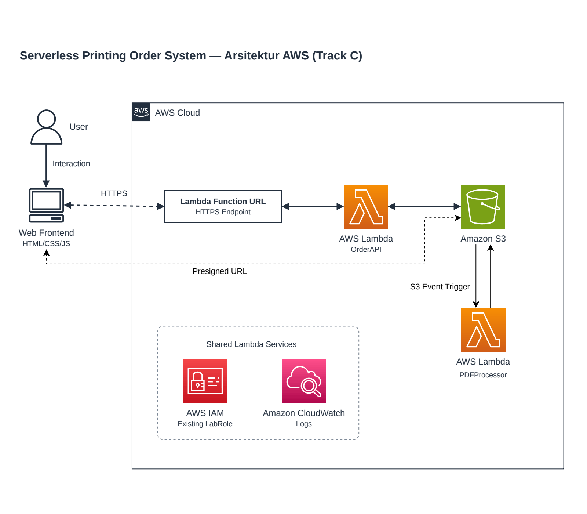

# Serverless Printing Order System

**Nama:** Putri Tajudin  
**NIM:** 24/535824/TK/59469  
**Mata kuliah:** Cloud Computing (individual project)  
**Track:** Track C (Serverless)  
**Tahap:** Week 12 (Design & AWS Setup)

## Deskripsi

Serverless Printing Order System adalah aplikasi web untuk memesan jasa percetakan. Pengguna mengunggah dokumen PDF, memilih spesifikasi cetak, memperoleh estimasi biaya yang dihitung otomatis dari jumlah halaman, dan memantau status pesanan.

Pada Week 12, repository ini berisi rancangan arsitektur, starter code, kode feasibility test, dan deployment plan. Aplikasi lengkap belum diimplementasikan.

## Tujuan dan use case

- **Use case:** Simple Orders, dengan entitas utama `PrintOrder`.
- **Tujuan:** membangun sistem pemesanan cetak berbasis layanan serverless. AWS Lambda menjalankan logika aplikasi, dan Amazon S3 menyimpan dokumen serta data pesanan.
- **Di luar scope versi awal:** payment gateway, integrasi printer fisik, OCR, dan sistem multi-role.

## Arsitektur

Diagram berikut adalah rancangan arsitektur target yang akan diimplementasikan, bukan kondisi aplikasi saat ini.



1. Frontend memanggil `OrderAPI` melalui Lambda Function URL (HTTPS).
2. `OrderAPI` mengelola data pesanan di S3 (`orders/{orderId}.json`) dan memberikan presigned URL kepada frontend.
3. Frontend mengunggah dan mengunduh PDF langsung ke dan dari S3 (`uploads/{orderId}.pdf`) dengan presigned URL.
4. Upload PDF ke `uploads/` memicu `PDFProcessor` melalui S3 Event Notification.
5. `PDFProcessor` memvalidasi PDF, menghitung jumlah halaman dan estimasi biaya, lalu menyimpan hasilnya ke S3.
6. Kedua Lambda memakai IAM `LabRole` dan mencatat log ke CloudWatch.

Komponen yang sudah diuji pada Week 12 tercantum di [Hasil pengujian Week 12](#hasil-pengujian-week-12).

## AWS services dan technology stack

| Komponen | Teknologi |
|---|---|
| Compute | AWS Lambda: `OrderAPI` dan `PDFProcessor` (Python 3.11, x86_64) |
| HTTPS endpoint | Lambda Function URL |
| Storage | Amazon S3 (satu private bucket), S3 Event Notification, S3 CORS |
| Access | AWS IAM (existing `LabRole`) |
| Monitoring | Amazon CloudWatch Logs |
| Library | Boto3, pypdf 7.1.1 |
| Frontend (planned) | HTML, CSS, vanilla JavaScript |
| Environment | AWS Academy Cloud Foundations Sandbox, `us-east-1` |

## Fitur

### Sudah dikerjakan (Week 12)

- Starter `OrderAPI` yang mengembalikan respons JSON `"Printing Order API is running"`.
- Feasibility test `PDFProcessor` dengan pypdf:
  - membaca PDF dari S3;
  - memeriksa batas ukuran 10 MB dan PDF terenkripsi;
  - menghitung jumlah halaman (maksimal 200);
  - menghitung estimasi biaya dengan konfigurasi dummy (A4, BW, 1 salinan, Rp500 per halaman).
- Pengujian koneksi Lambda–S3.
- Konfigurasi S3 CORS, Function URL CORS, dan S3 Event Notification.

### Direncanakan

- CRUD pesanan: membuat, melihat riwayat dan detail, mengubah spesifikasi, serta menghapus atau membatalkan pesanan.
- Upload dan download PDF melalui S3 presigned POST/GET.
- Spesifikasi cetak: ukuran A4/F4, hitam putih/warna, dan jumlah salinan.
- Estimasi biaya di backend: jumlah halaman × jumlah salinan × tarif per halaman.
- Pembaruan `orders/{orderId}.json` setelah PDF diproses (`Processed` atau `Rejected`).
- Pemantauan dan pembaruan status pesanan: Pending, Processing, Ready, Completed, Cancelled.
- Dashboard ringkasan pesanan.
- Frontend web.

Rencana endpoint `OrderAPI`: `POST /orders`, `GET /orders`, `GET /orders/{id}`, `PATCH /orders/{id}`, `DELETE /orders/{id}`, `PATCH /orders/{id}/status`, `GET /orders/{id}/download`, dan `GET /dashboard`.

## Struktur repository

```text
.
├── backend/
│   ├── order_api/
│   │   └── lambda_function.py      Starter OrderAPI
│   └── pdf_processor/
│       ├── lambda_function.py      Feasibility test validasi PDF, halaman, dan biaya
│       └── requirements.txt        Dependency PDFProcessor (pypdf)
├── docs/
│   ├── architecture-diagram.png    Diagram arsitektur
│   └── deployment-plan.md          Konfigurasi AWS dan langkah deployment
├── infrastructure/
│   └── cors.json                   Konfigurasi CORS bucket S3
├── tests/
│   ├── hello_world.py              Hello World test Lambda
│   └── test_s3_connection.py       Pengujian koneksi Lambda–S3
├── .gitignore
└── README.md
```

## Hasil pengujian Week 12

Pengujian dilakukan di AWS Academy Cloud Foundations Sandbox dengan data dummy. Evidence dikumpulkan terpisah dari repository.

| Komponen | Hasil |
|---|---|
| S3 bucket dan prefix `uploads/`, `orders/` | Berhasil dibuat; upload dan akses PDF berhasil |
| `OrderAPI` | Invocation Hello World berhasil |
| Koneksi Lambda–S3 | Berhasil: HTTP 200, PDF terbaca, JSON berhasil ditulis dan dibaca kembali |
| Lambda Function URL | Berhasil diakses dari browser dengan respons starter `OrderAPI` |
| `PDFProcessor` dan S3 Event Trigger | Berhasil: upload PDF ke `uploads/` memicu `PDFProcessor`, terlihat di CloudWatch Logs |
| Deployment dependency pypdf | Berhasil |
| Penghitungan halaman | Berhasil: dokumen uji terdeteksi 8 halaman |
| Estimasi biaya | Perhitungan 8 halaman × Rp500 menghasilkan Rp4.000; output akhir belum terverifikasi sepenuhnya |
| S3 CORS dan Function URL CORS | Dikonfigurasi; belum diuji dengan frontend |

Fitur pada bagian [Direncanakan](#direncanakan), termasuk presigned POST/GET dan frontend, belum diuji.

## Deployment

Resource AWS Sandbox terhapus ketika sesi berakhir, sehingga deployment diulang secara manual melalui AWS Console. Konfigurasi dan langkahnya ada di [docs/deployment-plan.md](docs/deployment-plan.md).

## Keamanan

- Repository tidak menyimpan AWS credentials, session token, Account ID, ARN, atau Function URL.
- Nama bucket dibaca dari environment variable `BUCKET_NAME`.
- Dokumen PDF tidak disimpan di repository.
- Function URL memakai auth type `NONE` dan hanya untuk pengujian awal dengan data dummy, bukan production endpoint.
